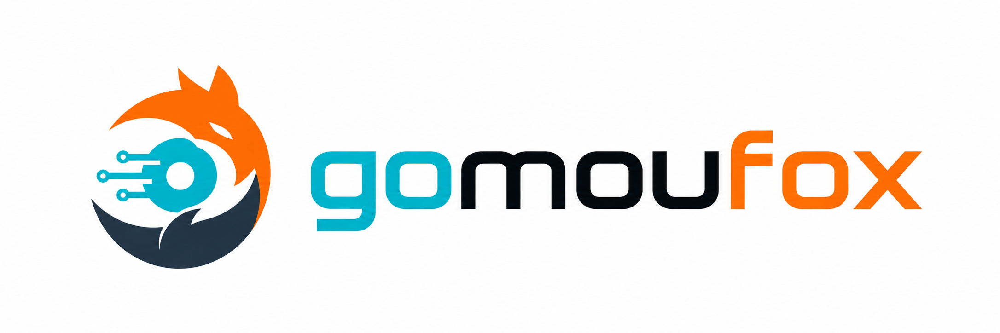
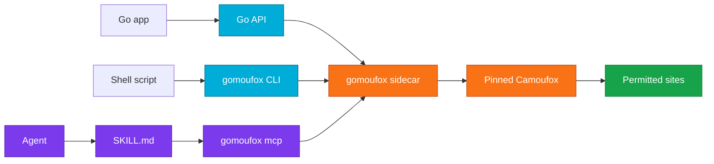

<p align="center">
  
</p>

# gomoufox

<p align="center">
  
  
  
  
  
</p>

gomoufox is a Go driver for Camoufox.

It gives Go programs, shell scripts, and MCP agents a typed way to launch and
control the pinned Camoufox browser stack without writing Python glue.

Use it only on sites you own, test, or have permission to automate.

## Add gomoufox to an agent

Install the bundled skills and MCP server config in one step:

```bash
gomoufox setup --dry-run
gomoufox setup --target all --features skills,mcp --yes
gomoufox agents install --target all --features skills,mcp --dry-run --json
gomoufox agents install --target all --features skills,mcp
```

Use `--target codex`, `claude`, `cursor`, or `gemini` to install for one
agent. Use `--scope project` when you want repo-local MCP config. The default
writes skill files plus a stdio MCP entry that runs
`gomoufox mcp --toolset core`.

Run the dry run first. It prints the exact files gomoufox would write. Without
`--force`, exact skill matches report `unchanged`; differing files report `needs_force`
and the apply step stops until you pass `--force`. MCP config files are merged.
JSON plans use `wrote`, `updated`, and `unchanged` for applied actions;
dry-run actions use `would_write`, `would_update`, `unchanged`, or `needs_force`.

## At a glance

| Need | Use |
|---|---|
| Go browser automation | `github.com/ehmo/gomoufox` |
| Shell automation | `gomoufox get`, `gomoufox screenshot`, `gomoufox fetch` |
| Containerized remote browser | `ghcr.io/ehmo/gomoufox` plus `gomoufox --server` |
| Interactive traffic capture | `gomoufox record` |
| Agent browser tools | `gomoufox mcp` |
| Guided setup | `gomoufox setup`, `gomoufox agents install` |
| Release evidence | [docs/BENCHMARKS.md](docs/BENCHMARKS.md) |



## Install

Library:

```bash
go get github.com/ehmo/gomoufox
```

CLI:

```bash
go install github.com/ehmo/gomoufox/cmd/gomoufox@latest
gomoufox -h
gomoufox install
gomoufox doctor
```

Homebrew:

```bash
brew tap ehmo/gomoufox https://github.com/ehmo/gomoufox
if brew commands | grep -qx trust; then
  brew trust --formula ehmo/gomoufox/gomoufox
fi
brew install gomoufox
gomoufox install
gomoufox doctor
```

Install through the tap. The release `gomoufox.rb` file is there for audit and
tap metadata; Homebrew wants formulae inside taps. Run `brew trust` only if your
Homebrew build still has that command.

## Docker and remote commands

The official Linux amd64 image runs the authenticated gomoufox daemon with the
pinned node-direct runtime already installed. Keep the host port on loopback
when the client runs on the same host:

```bash
export GOMOUFOX_DAEMON_TOKEN="$(openssl rand -hex 32)"
docker run --detach --rm --init \
  --name gomoufox \
  --publish 127.0.0.1:3741:3741 \
  --env GOMOUFOX_DAEMON_TOKEN \
  ghcr.io/ehmo/gomoufox:latest

gomoufox \
  --server http://127.0.0.1:3741 \
  get https://example.com \
  --markdown
```

Pin `ghcr.io/ehmo/gomoufox:vX.Y.Z` in deployment manifests. For connections
across hosts, put the daemon behind a private network or an HTTPS reverse proxy;
the bearer token does not encrypt plain HTTP. The remote API supports `get`,
`screenshot`, `fetch`, `eval`, and session import or export. It does not expose
the raw Playwright WebSocket, which would bypass gomoufox's network and data
guardrails.

The container defaults to the same conservative URL policy as local commands.
Arguments after the image name replace its default command, so include `serve`
and the container bind when overriding daemon flags:

```bash
docker run --rm --init \
  --publish 127.0.0.1:3741:3741 \
  --env GOMOUFOX_DAEMON_TOKEN \
  ghcr.io/ehmo/gomoufox:vX.Y.Z \
  serve --bind 0.0.0.0 --session-dir /opt/gomoufox/sessions \
  --allowed-hosts example.com
```

Add `--enable-eval` to allow remote `eval`, or `--allow-session-export` to
allow session export. Session files live under `/opt/gomoufox/sessions`; mount
that directory only when the deployment needs persistent session state.

| Path | Status | Use it when |
|---|---|---|
| `gomoufox install` |  | You want the Go-managed node-direct runtime. |
| `gomoufox install --runtime python` |  | You need BrowserForge, geoip, humanize launch options, or the legacy Python sidecar. |
| `GOMOUFOX_CAMOUFOX_PATH=/path/to/browser` |  | You already have a compatible Camoufox browser directory. |

Default Go, CLI, and MCP flows use the Go-managed node-direct runtime. The
default install assembles the exact Playwright 1.57 driver from checksum-pinned
official `playwright-core` npm and Node.js artifacts, writes the bundled launch
server and fetches the pinned Camoufox browser archive. Persistent profiles and
browser-context locale settings use the node-direct runtime; geoip and humanize
launch options still require the Python sidecar.

Use `gomoufox install --runtime python` only for the explicit legacy
Python-sidecar path. That path uses hash-locked wheels and the same exact-tag,
manifest-verified browser tree and checksum-pinned Playwright driver as
node-direct. It does not use Camoufox's moving global browser download, and
fails closed on a missing package or hash mismatch.

Homebrew installs on macOS Apple Silicon and Linux amd64, because those are the
hosts where the pinned browser has an upstream binary. Other Go archives still
ship for library and CLI users.

Use `GOMOUFOX_TRUST_UNVERIFIED_CAMOUFOX_PATH=1` only for a trusted local browser
build that does not match the release manifest. `gomoufox doctor` reports that
as a warning.

## Go library

```go
package main

import (
	"context"
	"fmt"

	gomoufox "github.com/ehmo/gomoufox"
)

func main() {
	ctx := context.Background()

	browser, err := gomoufox.New(ctx)
	if err != nil {
		panic(err)
	}
	defer browser.Close()

	page, err := browser.NewPage(ctx)
	if err != nil {
		panic(err)
	}

	if _, err := page.Goto(ctx, "https://example.com"); err != nil {
		panic(err)
	}

	text, err := page.Content(ctx)
	if err != nil {
		panic(err)
	}
	fmt.Println(text)
}
```

Use the library when your program owns the browser lifecycle. Use the CLI when a
shell script needs a page snapshot, screenshot, or browser-context fetch. Use MCP
when an agent needs browser tools over stdio or HTTP.

HAR recording is a context option and finalizes on `Context.Close` (or when its
owning page closes):

```go
recording, err := browser.NewContext(ctx, gomoufox.WithHARRecording(gomoufox.HAROptions{
	Path:    "capture.har",
	Capture: gomoufox.HARCaptureMetadata,
}))
if err != nil {
	panic(err)
}
defer recording.Abort() // discards an unfinished capture on an early return
page, err := recording.NewPage(ctx)
if err != nil {
	panic(err)
}
if _, err := page.Goto(ctx, "https://example.com"); err != nil {
	panic(err)
}
if err := recording.Close(); err != nil {
	panic(err)
}
result, ok := recording.HARResult()
```

Check `ok` before using `result`. Metadata capture is the default and redacts
standard value-bearing fields while dropping unknown fields; it is still
sensitive. `HARCaptureFull` preserves request and response content. A successful
`Close` makes the deferred `Abort` a no-op.

## CLI

```bash
gomoufox get https://example.com --markdown
gomoufox screenshot https://example.com --out page.png --full-page
gomoufox screenshot https://example.com --out mobile.png --width 390 --height 844
gomoufox fetch https://api.example.com/me --navigate-first https://example.com
gomoufox open https://app.example.com --save-session state.json --wait
gomoufox fetch https://app.example.com/api/me --cookies-file state.json
gomoufox record https://app.example.com --out capture.har
```

`get`, `eval` and `screenshot` accept `--width` and `--height` in CSS pixels.
Their `--timeout` budget starts after browser startup and covers navigation,
selector readiness and capture; a selector wait uses the remaining budget.
MCP `session_create` accepts the same settings as `width` and `height`.
Screenshot JSON reports encoded image `width` and `height`, the
`requested_viewport`, and `rendering` metrics with effective CSS dimensions and
`device_pixel_ratio`. Full-page and clipped captures can have different image
and viewport dimensions.

`rendering` also reports the host OS, requested OS fingerprint, browser platform,
body font family and up to 32 web-font loading states. `--os` selects a Camoufox
fingerprint; it does not install fonts or turn the host into that OS. Loaded
fonts do not prove that every character has a glyph, so `glyph_coverage` remains
`not_verified`. For repeatable typography, serve the required web fonts with the
page and inspect representative characters in the capture. Unavailable metrics
are marked explicitly.

Fetch responses are read through a bounded browser stream. `gomoufox fetch`
defaults to 512 KiB, reports truncation in JSON output, and cancels the reader
when the cap is reached.

`gomoufox record` opens a headful browser and records the operator's workflow
until the window closes. The default `metadata` capture removes bodies and
redacts header, cookie, query, and form values, but the resulting HAR is still
sensitive. `--capture full` preserves request and response content and prints a
warning; use a narrow `--url-filter`, keep the file private, and inspect it
before sharing.

Agent-friendly discovery:

```bash
gomoufox -h
gomoufox -v
gomoufox version
gomoufox help
gomoufox help --json --fields commands
gomoufox help skills --json
gomoufox help mcp --json
gomoufox skills list --json
gomoufox skills show core
gomoufox mcp --help
```

Automation tips:

- Use `--json` for machine-readable output and keep status logs on stderr.
- Use `--timeout <dur>` for bounded shell jobs.
- Use `open --save-session` for human login, then reuse the state with
  `--cookies-file`. Save storage state for session-cookie handoff; Firefox
  drops session cookies on restart, so a profile alone does not keep them.
  `open --profile` without `--save-session` warns on stderr when the run set
  session cookies.
- Use `--profile <dir>` when a workflow needs full persistent browser state.
  Relative CLI paths resolve from the command's working directory. Each local
  CLI call starts and closes its own browser; without a profile or imported
  state, separate calls do not share login or page state. Use MCP named sessions
  or a running daemon when later calls need the same live browser.
- Keep the default URL policy for normal work. Use `--allow-localhost` only for
  explicit localhost or loopback HTTP(S) targets.

### Local development servers

CLI browser commands can reach a local server with the narrow loopback opt-in:

```bash
gomoufox --allow-localhost get http://127.0.0.1:3000 --text
gomoufox --allow-localhost screenshot http://localhost:3000 --out page.png
```

For MCP, set the policy when starting the server. It cannot be enabled by an
individual tool call:

```bash
gomoufox mcp --allow-localhost
```

Go callers set the same browser filtering proxy policy with an option:

```go
b, err := gomoufox.New(ctx, gomoufox.WithAllowLocalhost(true))
```

The option permits explicit `localhost`, `127.0.0.0/8`, and `::1` HTTP(S)
targets. It does not permit broader private networks or metadata endpoints.

## Skills

gomoufox ships versioned agent skills in the binary and as checked `SKILL.md`
files. Skills give agents a compact operating guide for the Go API, CLI, and MCP
tools. They do not install npm packages, run `npx`, or call the network.

| Skill | Path | Use it when |
|---|---|---|
| `core` | `skills/gomoufox/SKILL.md` | An agent needs the Go library or CLI workflow. |
| `mcp` | `skills/gomoufox-mcp/SKILL.md` | An agent needs MCP setup, tool choice, and browser safety rules. |

Inspect the embedded skills:

```bash
gomoufox skills list --json
gomoufox skills show core
gomoufox skills show mcp
```

Export installable copies:

```bash
gomoufox skills export --out ./skills
gomoufox skills export --out ./skills --force
```

Install skill files only for Codex:

```bash
gomoufox skills install --target codex --dry-run --json
gomoufox skills install --target codex
```

By default, the Codex target writes to `$CODEX_HOME/skills` or
`~/.codex/skills`. Use `--dir <path>` to choose another skill directory. The
installer writes:

- `gomoufox/SKILL.md`
- `gomoufox/agents/openai.yaml`
- `gomoufox-mcp/SKILL.md`
- `gomoufox-mcp/agents/openai.yaml`

`list` and `show` read from the embedded skill bodies, so agents can discover
the right instructions even when no skill directory exists yet. `export` and
`install` write the same checked bodies that ship in the repo. They refuse to
replace existing files unless you pass `--force`.

Install skills plus MCP configuration for a specific agent or project:

```bash
gomoufox agents install --target all --dry-run --json
gomoufox agents install --target cursor --scope project --features skills,mcp
```

`agents install` supports `codex`, `claude`, `cursor`, `gemini`, or `all`, with
`--scope user|project` and `--features skills,mcp`. MCP entries use stdio and
default to `gomoufox mcp --toolset core`. Use `--toolset full` for the full MCP
surface. Reserve repeated `--mcp-arg <arg>` for extra MCP server flags. Use
`--force` when `needs_force` identifies a differing skill file that you intend
to replace, or to rewrite an exact match with mode `0600`. MCP config is merged.

| Target | User-scope MCP file | Project-scope MCP file | Skill root |
|---|---|---|---|
| `codex` | `~/.codex/config.toml` | `.codex/config.toml` | `~/.agents/skills` or `.agents/skills` |
| `claude` | `~/.claude/mcp.json` | `.mcp.json` | `~/.claude/skills` or `.claude/skills` |
| `cursor` | `~/.cursor/mcp.json` | `.cursor/mcp.json` | `~/.agents/skills` or `.agents/skills` |
| `gemini` | `~/.gemini/settings.json` | `.gemini/settings.json` | `~/.agents/skills` or `.agents/skills` |

Dry-run output shows the exact absolute paths that would be written.

## MCP

Rejected tool arguments include `argument_error` with the field, rule and
correction from the live schema. Browser failures retain their error code and
add a safe `reason`, `message` and `hint`. Reasons distinguish timeout, closed
sessions, stale refs, ambiguous selectors, frame changes, runtime/launch
failures, network failures and script errors. Raw driver text and supplied
values are omitted.

Form-batch failures report `phase`, `completed_actions`, zero-based
`failed_index` and `total_actions`. Validation failures mean no actions ran.
Execution failures leave completed actions applied and mark the failed action
as possibly applied. Inspect the page before resuming; replaying the whole
batch can repeat side effects.

Run browser tools over stdio:

```bash
gomoufox mcp
```

Claude Code example:

```bash
claude mcp add gomoufox -- gomoufox mcp
```

HTTP transport requires a bearer token:

```bash
gomoufox mcp --transport http --auth-token "$TOKEN"
```

MCP defaults:

- Use `gomoufox mcp --toolset core` for a smaller agent tool surface. It keeps
  navigation, snapshots/content, common form actions, sessions, and skill tools.
  The default `full` toolset keeps diagnostics, eval, fetch, cookies, storage,
  upload, and other gated tools available.
- `file://`, private IP ranges, link-local addresses, and metadata hosts are
  blocked.
- `gomoufox mcp --allow-localhost` permits explicit loopback HTTP(S) targets
  (`localhost`, `127.0.0.0/8`, `::1`) for local app testing while keeping
  broader private networks, metadata hosts, DNS rebinding, and unsafe redirects
  blocked.
- JavaScript evaluation is disabled unless you start MCP with `--enable-eval`.
- Response sizes are capped.
- MCP-owned helper scripts use a startup-probed internal helper evaluation path
  and do not install a page-visible helper object.
- Browser-derived MCP responses include `provenance.trust: "untrusted"` so
  agents can separate website content from trusted instructions. This label helps
  agent policy. It is not a sandbox.
- Console, page-error, network, and performance diagnosis tools are bounded,
  redacted, and clearable where they keep event buffers. Network summaries do
  not include request or response bodies.
- Ref-based interaction tools cover click, type, key press, hover, scroll,
  select option, checkbox/radio state, dialog policy, and bounded form batches.
- `browser_snapshot` form values stay redacted unless you start MCP with
  `--allow-snapshot-values` and the tool call sets `include_values: true`.
- Browser-context fetches, cookie values, cookie mutation, session export,
  session import, session proxy use, file upload, and file download stay
  disabled unless you enable their matching operator flags.
- HAR recording stays disabled unless MCP starts with `--allow-har-recording`.
  Call `browser_har_start` before using its named session and
  `browser_har_stop` to finalize it. Pass `storage_state_path` at start rather
  than calling `session_load` on an active recording; each destination remains
  exclusively reserved until finalization returns. Full capture also requires
  `--allow-har-sensitive-values`; even metadata HAR files remain sensitive and
  returned routes are untrusted website-controlled data.
- For login inside MCP, create `session_create` with `headful: true`, then
  navigate using that session ID to open its visible window. Complete login,
  wait for a signed-in selector, and call `session_save` while the session is
  alive (`--allow-session-export` is required). Continue with the same session ID.
  The session owns a dedicated browser; `session_destroy` closes it.
- MCP profile paths resolve under `--session-dir/profiles`. A profile belongs to
  one named session until cleanup finishes. `profile_in_use` names the owning
  session when this server knows it; reuse that ID. For a profile held by another
  process, close its owner or choose another directory. Keep lock files intact.
  `session_list.state_source` distinguishes ephemeral, profile and imported state.
- To reuse a CLI login in MCP, save state with `gomoufox open --save-session`,
  place the file under `--session-dir`, start MCP with `--allow-session-import`,
  then call `session_create` with `storage_state_path` or `session_load` with
  `path`.
- `browser_upload_file` requires `--allow-file-upload`; paths must resolve under
  `--session-dir`, and responses do not echo file paths.
- `browser_download` requires `--allow-file-download`; destination paths must
  resolve under `--session-dir`. Suggested filenames from the browser are
  returned as metadata only and are never used as write paths.
- `browser_fetch` requires `--allow-browser-fetch` plus at least one
  `--allowed-origins` or `--allowed-hosts` entry. It still uses gomoufox network
  policy, so private and metadata destinations stay blocked.

## Benchmarks

The benchmark answers one question: did the Go path stay close to Python
Camoufox without producing Go-only failures?


Latest checked evidence:
[docs/BENCHMARKS.md](docs/BENCHMARKS.md),
[8-site baseline](docs/benchmarks/2026-10-28-full.json), and
[100-site node-direct artifact](docs/benchmarks/2026-10-28-node-direct-readiness.json).
Both runtimes in the extended comparison used this
[shared Linux persona](docs/personas/2026-09-08-node-direct-readiness.json).
The current figures include each complete harness process tree: the runner,
drivers and browser. Both runtimes use a fixed sampling period that includes
snapshot collection time. Earlier artifacts used a narrower Go resource scope
and different sampling cadences.
Earlier Python-sidecar results remain in the
[2026-06-08 artifact](docs/benchmarks/2026-06-08-release-gate.json).

| Runtime | Passed | Blocked | Failed | Wall ms | Peak RSS MiB | Peak CPU % | Report tokens |
|---|---:|---:|---:|---:|---:|---:|---:|
| Python Camoufox | 87 | 13 | 0 | 345,438 | 2,686.4 | 478.3 | 83,172 |
| gomoufox, node-direct Go | 89 | 11 | 0 | 346,182 | 2,548.7 | 451.0 | 13,192 |

Outcome counts come from the second loop; wall time averages both loops, and
resource figures use the larger peak.

Latest extended validation: 100 targets, 60s timeout, `commit` wait, 3s settle,
no screenshots, reused browser, compact Go report, 0s extra load-state wait, and
250,000-byte classification cap. The artifact contains two alternating loops.
gomoufox passed 89, blocked 11, failed 0. Python Camoufox passed 87, blocked 13,
failed 0. The run had 0 persistent Go-only regressions and 2 paired outcome
mismatches. See the
[extended artifact](docs/benchmarks/2026-10-28-node-direct-readiness.json).

| Ratio | node-direct Go / Python Camoufox |
|---|---:|
| Wall time | 1.002 |
| Peak RSS | 0.949 |
| Peak CPU | 0.943 |
| Report tokens | 0.159 |

The release evidence check passed its timing, resource and report-size limits.
The node-direct benchmark reports `candidate`; all its recorded criteria passed.
Its RSS and CPU criteria each require a ratio at or below 0.95.
Consumer no-Python readiness is checked separately. Treat a report-token ratio
above 0.50 as a regression.
Release gates use `--unsafe-direct-network`, block reproducible outcome mismatch,
and give a new shared block, failure, or performance outlier one focused retry.
If that retry differs by outcome, the gate runs one paired confirmation in the
opposite runtime order and blocks a persistent mismatch.
Release benchmark evidence uses two alternating loops so each runtime runs
first once. Across those loops, a target counts as Go-only only when its Go-only
outcome persists in every paired observation. The artifact still records every
paired mismatch.

```bash
scripts/benchmark-realpass.py --mode smoke --go-sidecar-runtime node-direct
scripts/benchmark-realpass.py --mode smoke --go-sidecar-runtime node-direct --loops 2 --run-order alternate
scripts/benchmark-realpass.py --mode extended --go-sidecar-runtime node-direct --loops 2 --run-order alternate
scripts/benchmark-realpass.py --mode extended --list-targets
scripts/fingerprint-audit.py
```

Use `--run-order alternate` for timing work. Run `scripts/fingerprint-audit.py`
after browser pin, launch option, WebGL, locale, timezone, font, canvas, or
runtime changes. It compares Python Camoufox, gomoufox with the Python sidecar,
and gomoufox node-direct on a local fingerprint page.

The no-Python canary checks the consumer path:

```bash
scripts/no-python-consumer-canary.sh --gomoufox ./gomoufox --json-out dist/node-direct-consumer-readiness.json
python3 scripts/check-python-removal-readiness.py --artifact dist/node-direct-consumer-readiness.json
```

More detail:

- [Benchmark rules and target matrix](docs/BENCHMARKS.md)
- [Release verification](#release-verification)
- [Python tooling policy](scripts/python-tooling-policy.json)
- [Public consumer canary](scripts/public-consumer-canary.sh)

## Release verification

Each public release ships deterministic archives, `checksums.txt`,
`checksums.json`, a Homebrew formula, `release-provenance.json`, and
`sbom.spdx.json`. The public workflow also creates GitHub artifact attestations.

```bash
gh release download vX.Y.Z --repo ehmo/gomoufox --dir /tmp/gomoufox-vX.Y.Z
cd /tmp/gomoufox-vX.Y.Z
shasum -a 256 -c checksums.txt
gh attestation verify gomoufox_X.Y.Z_darwin_arm64.tar.gz -R ehmo/gomoufox
```

Run the public consumer canary when you want one command that checks the release
asset layout, checksums, host archive extraction, CLI help, MCP core handshake,
skills listing, and skills install dry-run:

```bash
bash scripts/public-consumer-canary.sh --version vX.Y.Z --repo ehmo/gomoufox --brew-mode inspect
```

Add `--verify-attestations`, `--go-install`, or `--brew-mode install` when you
need those slower paths. The default canary avoids browser launch work. Add
`--browser-smoke-url https://example.com/` when you also want to prove the
managed runtime is installed and usable on that machine.

Maintainers also run the bundled public audit after publication:

```bash
python3 scripts/audit-public-release.py \
  --version vX.Y.Z \
  --repo ehmo/gomoufox \
  --verify-attestations \
  --brew-mode inspect
```

## Common questions

### Where is Python still used?

Default install and ordinary node-direct flows do not need Python at runtime.
Python remains for explicit legacy Python-sidecar mode, geoip/humanize
launch-option flows, upstream Python Camoufox comparison benchmarks, and
maintainer release/dev scripts listed in `scripts/python-tooling-policy.json`.

The audit path still exists for upstream parity work:

```bash
go run ./cmd/gomoufox-launchplan --scenario all --out dist/launch-plan/latest
```

That command dumps gomoufox's Go launch input beside the Python Camoufox launch
payload. It can also compare an optional candidate payload with
`--candidate <json>` and fails on drift.

### Why use gomoufox instead of Python Camoufox directly?

Use gomoufox when you need a typed Go API, a scriptable CLI, MCP tools for
agents, release-gated Go/Python parity checks, and local URL guardrails. Use
Python Camoufox directly when your project is already Python-first and does not
need those surfaces.

### Will every protected site work?

No. gomoufox tests against Python Camoufox on the same target set. A Go-only
block or failure is a gomoufox regression. A shared block means both stacks saw
the same site behavior during that run. Site policy, traffic reputation, browser
changes, and upstream Camoufox changes can still affect results.

### Where does browser state live?

Temporary sessions use temporary profile data. Persistent sessions use the
directory you pass with `--profile`. MCP session import, export, proxy use, and
file upload stay disabled until you start MCP with the matching operator flags.
Portable `storage_state` files from `open --save-session` contain cookies and
localStorage only; reuse them with CLI `--cookies-file` or MCP session import.

### Does MCP trust page content?

No. Browser-derived MCP responses carry `provenance.trust: "untrusted"`. Agents
should treat page text as data from the site, not instructions from the operator.

### Can I run headful on Linux?

Yes, if a display exists. Set `GOMOUFOX_AUTO_DISPLAY=1` when you want gomoufox to
use an automatic display helper.

### How do I debug install issues?

Run:

```bash
gomoufox doctor
gomoufox doctor --json
gomoufox --verbose doctor
```

Doctor reads the cache without installing or repairing it. Use `--dir` to inspect
a custom install directory and `--runtime python` for the legacy environment.
The report separates the running executable and build from the binary on `PATH`,
and expected runtime pins from observed package versions and asset integrity.
It does not check whether a newer release exists. Failed checks include repair
commands scoped to that executable and cache. `gomoufox install --json` separates
disabled downloads, unavailable upstream assets, integrity failures and version
mismatches, and returns a doctor command for the selected installation.

Repair stages and verifies the complete browser runtime before replacing it.
Python package upgrades use a new `python-envs/env-*` directory inside the cache;
an atomic marker selects it only after packages and runtime assets pass checks.
The directory keeps its original path so Python script interpreter paths remain
valid. Failed upgrades preserve the previous installation. Previous Python
environments remain on disk for processes that still use them.

`GOMOUFOX_CAMOUFOX_PATH` selects an offline installation source. Doctor checks the
managed cache, including its integrity when
`GOMOUFOX_TRUST_UNVERIFIED_CAMOUFOX_PATH=1` is set. That override does not turn a
failed integrity check into a passing report.

### How do I recover from a blocked request?

A `network_policy` failure identifies a local guardrail rejection. Check the
running MCP connection with `browser_capabilities`; an authorized configuration
change requires restarting that connection. CLI loopback access needs
`--allow-localhost`. Changing transports does not remove the policy constraint.

CLI get/fetch and MCP navigation/fetch report observed HTTP status separately.
HTTP errors add `http_recovery` with guidance for authentication, access denial,
rate limits or server failures. Content remains inspectable, and a 403 or 503
alone is not labeled a bot check. Stop unchanged retries, observe the site's
limits and use approved login or documented APIs only when authorized. Browser
automation does not guarantee success on a site's checks.

## Compatibility

gomoufox pins the browser stack. Upgrade these pieces together.

| gomoufox | playwright-go | Playwright package | Camoufox package | Camoufox browser |
|---|---|---|---|---|
| v0.1.x | v0.5700.1 | 1.57.0 | 0.4.11 | v135.0.1-beta.24 |

Auto-fetch support is verified for macOS arm64 and Linux amd64. Other platforms
may work with a pre-provisioned browser directory through
`GOMOUFOX_CAMOUFOX_PATH`.

Headful Linux runs need an existing display or `GOMOUFOX_AUTO_DISPLAY=1`.

## Development

These Python commands are development tooling, not runtime prerequisites:

```bash
go test -count=1 ./...
go test -race -count=1 ./...
go vet ./...
python3 scripts/check-agent-contracts.py
python3 scripts/format-doc-numbers.py
go run golang.org/x/vuln/cmd/govulncheck@v1.3.0 ./...
```

Normal CI keeps to cheap deterministic checks: public export consistency,
docs-number formatting, unit tests, agent contracts, `go vet`, and the public
consumer canary in dry-run mode. Public tag releases run the heavier coverage,
vulnerability, package, attestation, and post-release audit checks.

Agent-facing discovery snapshots live in `docs/agent-contracts/`, including the
[typed CLI flag catalog](docs/agent-contracts/cli-flags.json). When CLI flags,
MCP schemas or embedded skills change, run
`python3 scripts/check-agent-contracts.py --update` and review the diff. It also
generates CLI reference tables and installable skills, and checks command examples
against the live flag schemas.

Run `python3 scripts/format-doc-numbers.py --write` after editing docs with
large displayed numbers.

The public repo is generated. Do not edit generated public files by hand.

## License

gomoufox is MIT licensed.

Camoufox is MPL-2.0. gomoufox starts Camoufox as a subprocess and downloads its
browser binary at runtime. gomoufox does not vendor or modify Camoufox.

Evaluation deadlines close the affected page to stop pending JavaScript. Recreate
the MCP session after `evaluation_interrupted`; inspect persisted state before
repeating an operation that may have had side effects.

For complete binary downloads, use `gomoufox fetch <url> --out file.pdf` with
`--navigate-first <page-url>` or `--cookies-file state.json` when the request needs
authentication. File acquisition defaults to 50 MiB; `--max-file-bytes` may lower
that limit. The response is held within that byte budget, then written atomically
with mode 0600. JSON metadata includes its byte count and SHA-256 digest. Existing
files require `--overwrite`. Truncation, HTTP errors and failed transfers leave the
destination unchanged. `--max-bytes` remains the text-preview budget; plain stdout
fails on truncation, while `--json` can return a preview with `truncated: true`.

CLI file uploads accept up to 50 MiB through `--data-file`; inline `--data` keeps
its 1 MiB text cap. Use `gomoufox fetch <url> --form note=value --form-file
image=path/to/image.png` for multipart uploads. The default method is POST when
multipart flags are present. Fields and files may repeat; the complete multipart
body, including its boundary, must fit within 50 MiB. The command supplies the
Content-Type boundary. Authentication uses the same browser profile, cookies or
`--navigate-first` page as other fetch requests.

MCP `browser_fetch` accepts `body_path` for a binary request file under
`--session-dir`, up to 50 MiB. It requires `--allow-browser-file-fetch` in addition
to browser fetch and target-scope opt-ins. `body` and `body_path` are exclusive.
`browser_fetch_form` accepts file paths for multipart endpoints. Neither file route
requires embedding bytes in scripts or MCP messages. `browser_fetch.timeout_ms`
bounds the whole navigation-and-fetch operation, defaulting to 30 seconds.

MCP evaluation accepts expressions or functions. A function receives the supplied
`arg` value: `arg => arg.token`. No global `arg` is created. Promise results are
awaited within the evaluation deadline; pending main-world results use a temporary
page property that is removed after completion. Explicit main-world scripts are
visible to the page. Internal snapshot and extraction helpers keep their separate
isolated execution path.

Call `browser_capabilities` before using optional MCP features. It reports the
running connection's gates, limits, network scope and diagnostic availability
without launching a browser. Both toolsets expose it. Diagnostic tools require
`--toolset full`; changing the command requires restarting the client connection.
Inspect the report again after restart. File and cookie suboperations retain
their separate gates, and an enabled tool still obeys network policy.

`gomoufox setup --recipe research --dry-run` previews the default core setup.
`gomoufox setup --recipe local-development --dry-run` selects the full toolset
and adds `--allow-localhost`. Both recipes leave evaluation, fetch, file transfer
and storage gates disabled unless explicitly supplied through `--mcp-arg`.
An explicit `--toolset` overrides the recipe. Setup validates the resulting stdio
command, shows its argument array and names the required connection restart.

MCP `session_limit` errors report capacity and bounded active session IDs.
`session_list` also reports used and available slots. After a rejected create,
inspect existing sessions before reusing one or destroying one you no longer
need. A session recording HAR must finish recording before ordinary destruction.

Use `session_create` with `reuse_if_exists: true` and the same creation settings
to acquire a named session. It reports `created`, `reused` and `browser_started`;
a settings conflict leaves the existing session intact. Continue with
`browser_navigate` and `require_existing: true` to prevent implicit creation after
a failed acquisition or expiry. Stop on an acquisition error before navigating.

Reader text omits scripts, styles, templates and explicitly hidden subtrees,
while preserving block boundaries. Whitespace is normalized; stylesheet-based
visibility is not inferred. Markdown keeps its `article` or `fallback` quality
label, and MCP extraction reports truncation if either acquired representation
reached its budget.

Content JSON includes `extraction_method`: `dom_html`, `reader_text`, `article`
or `reader_fallback`. MCP `truncation_sources` separates `html_acquisition`,
`text_acquisition` and final `output` caps. A fallback can contain the complete
reader text even when its HTML acquisition was truncated. Output byte counts
stay within the requested cap without splitting UTF-8 characters. Plain CLI
output reports truncation on stderr; it no longer appends bytes beyond the cap.
